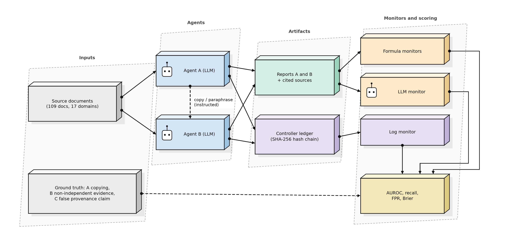
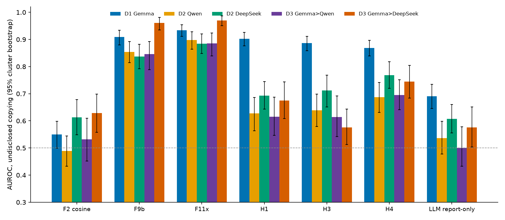
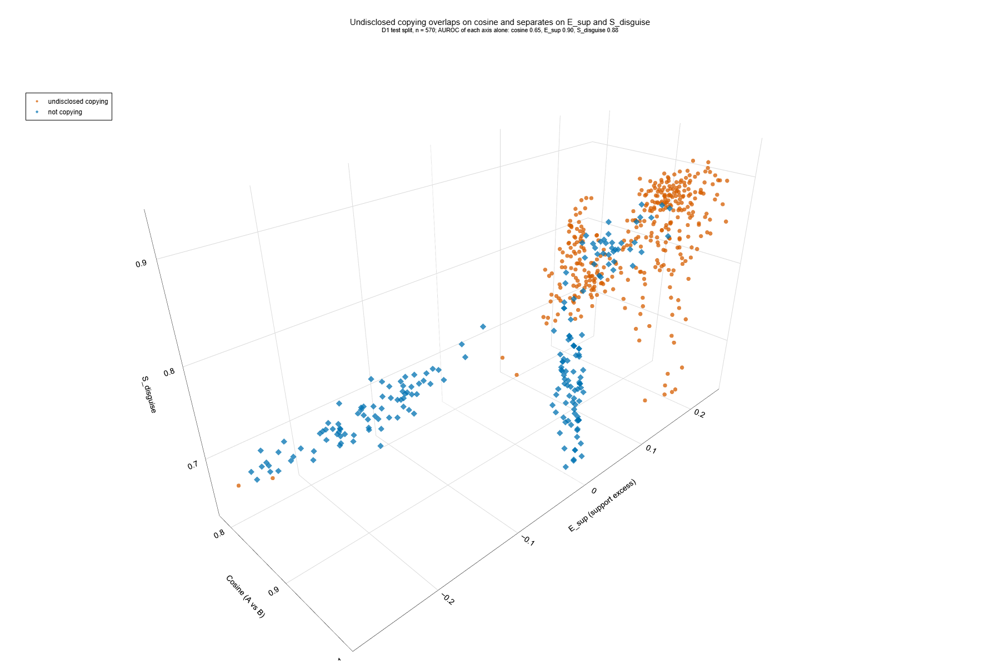
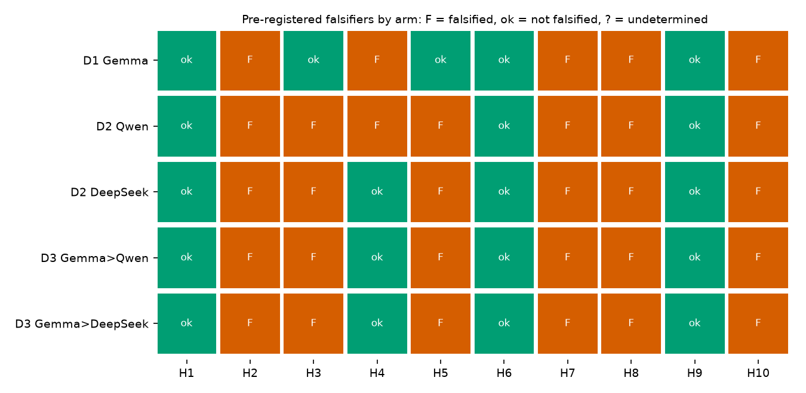
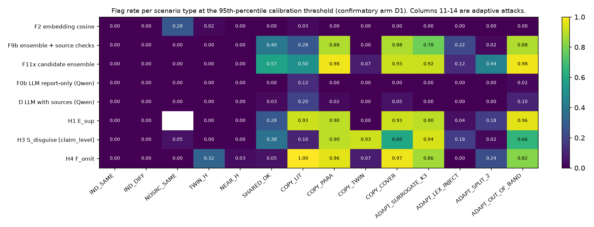
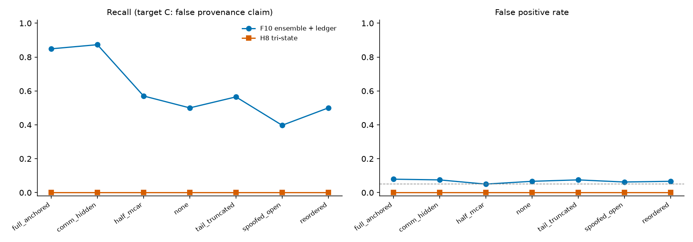
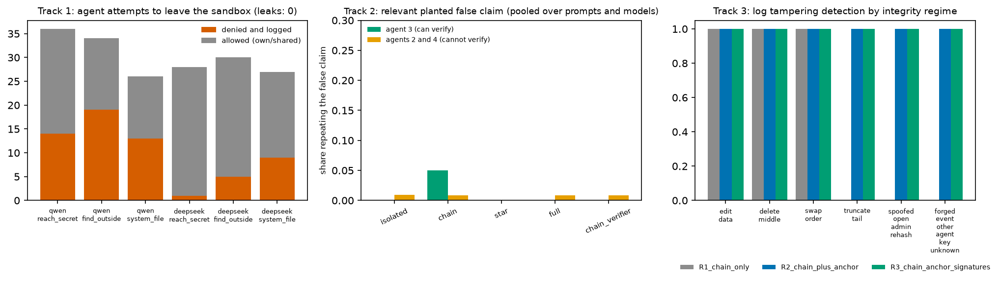

# Detecting undisclosed copying between LLM agents: a pre-registered re-test of formula monitors

*Full results report (English). Every number below is generated from result files in `retest_v2/results`; nothing is typed by hand except the prose. Authors and affiliations: to be filled in by the authors.*

## 1. What was tested, in one paragraph

LLM agents wrote evidence reports from the authors' 109 course documents (17 domains). In a controlled test bed, some agents were instructed to copy another agent's report and to claim independent evidence. Monitors then audited the finished reports, the cited sources and a hash-chained log, once per scenario, offline. The question: can monitors tell undisclosed copying from honest similarity (same topic, honest twin sources, no source), and do candidate features from an AI-assisted gap analysis add anything beyond a strong in-house baseline and plain embedding cosine?

## 2. Evidence status and what was done before the sprint

| stage | what | status of its numbers |
|---|---|---|
| Pilot (scripted bots, no LLM) | 184 books, 5 seeds | pilot only, no claim rests on it |
| Study D0 | 820 scenarios, Gemma agents | exploratory and contaminated: formulas were designed while looking at this data |
| Re-test D1 | Gemma agents, 5 replicates, fresh seeds | **confirmatory, main arm** |
| Re-test D2 | Qwen (3 replicates) and DeepSeek (3 replicates) agents | confirmatory |
| Re-test D3 | Gemma writes A, Qwen or DeepSeek writes B (2 + 2 replicates) | confirmatory, mixed-model |

Formulas STP, STP-AR, MOI, RCC-v3.3, the older formula library and the course documents existed before the sprint (see `PREEXISTING_WORK.md`). The controller, the scenario plan, the ledger, the monitors, the metrics engine, the candidate-feature composition (F11x) and all tests were built during the sprint (`SPRINT_CONTRIBUTIONS.md`).

## 3. Method

**Scenarios.** 14 types: honest cases (independent, same topic, honest twin sources, near duplicates, disclosed shared evidence, no source) and four copy variants (literal, paraphrase, via twin source, with cover text) plus four adaptive attacks written against the monitors (surrogate-guided rewrite, lexical injection, split citation, out-of-band copy). Primary target A is *undisclosed copying* (disclosed sharing counts as negative). Target B is non-independent evidence. Target C is a false provenance claim. **In this design the labels of A and C are {{LABELS_A_C}}** (every undisclosed copy also carries a false independence claim), so C does not give independent confirmation; it matters only through the log-degradation analysis and the LLM field it reads.

**Calibration and test.** For every replicate, thresholds and logistic fits use that replicate's own calibration split; the test split (disjoint source documents) is scored once. Threshold = 95th percentile of calibration negatives (nominal false-positive rate 5%). Uncertainty: cluster bootstrap by source document (1000 resamples) and, for the primary monitors, a refit bootstrap (500 resamples that refit thresholds and models).

**Monitors.** F2 embedding cosine (standard baseline); F9b in-house ensemble (logistic regression on 11 features: lexical overlap, cosine, STP, STP-AR, STP-AR+MOI, RCC-v3.3 with MOI, two older-library features and three source checks); **F11x** = F9b plus four features from the candidate analysis (H1 support excess, source-presence flag, H3 semantic-lexical contrast, H4 omission footprint); candidate monitors H1 to H10 each tested against a falsifier fixed before scoring; LLM monitors (Qwen, with and without sources); log monitors on the SHA-256 hash chain in seven log conditions. All monitors are offline: they audit after the fact and do not watch agents in real time.

**Pre-registration.** Formulas, hypotheses and falsifiers were hash-locked before D1 to D3 were scored; analysis code was locked before scoring. Eleven code or protocol changes and one resource change are listed in Appendix C. No constant was changed after seeing confirmatory results.

### Data and audit

{{DESIGN}}

## 4. Results

### 4.1 Primary comparison (target A, undisclosed copying), all five arms

{{PRIMARY5}}

Main arm D1 in detail (refit bootstrap, 500 resamples):

{{PRIMARY}}

F11x beats plain cosine in every arm by a wide margin; its gain over the in-house F9b is small and clears the strict gate in three arms only. Cosine alone is close to chance because honest pairs on the same topic are as similar as copies (Figure 3).

The three axes are cosine, H1 support excess and H3 contrast; on a single axis AUROC is 0.65, 0.90 and 0.88 (title of the figure). Some honest cases fall inside the copy cloud: separation is good, not perfect. An interactive version is `fig6_scatter3d.html`.

### 4.2 Pre-registered hypotheses

{{FALSIFIERS}}

Held in all five arms: H1, H6, H9. Falsified in all five: H2, H7, H8, H10. H3 and H5 held only in D1; H4 held in three of five arms. Numbers behind the D1 verdicts:

{{FALSIFIER_NUMBERS}}

The H8 row is empty because its verdict is a per-log-mode table (Section 4.5). **H1 and H3 reach AUROC 1.00 on their contrasts** (copy versus honest sourced reports; copy-via-twin versus honest twin): perfect separation in a synthetic test bed usually reflects an easy design, not a perfect method.

### 4.3 Monitor performance, target A, per arm

**D1 (main arm) and the other arms** (recall and false-positive rate at the calibrated threshold, AUROC with cluster-bootstrap interval, Brier):

{{MONITORS_A}}

The Qwen LLM monitor is calibrated like every other monitor, so at a 5% false-positive budget it flags almost nothing for target A (recall 0.01 to 0.15 in the arms above), while its AUROC on target B is high. An uncalibrated threshold of 0.5 behaves differently: in an exploratory run on 97 D1 items, Qwen and a Claude Haiku monitor both flagged 66% of honest cases at 0.5 (see Appendix D).

### 4.4 Per scenario type and adaptive attacks (D1, share flagged)

{{ADAPTIVE}}

Weak spots to report as they are: lexical injection (ADAPT_LEX_INJECT) lowers F11x to about 12% flagged, split citation (ADAPT_SPLIT_2) to about 44%, and copy via twin source is caught mainly by H3, not by F9b or F11x. F11x also flags more than half of the disclosed-sharing cases (SHARED_OK), which are negatives by design.

### 4.5 Logs: degradation and the three-valued rule (D1)

{{LOGMODES}}

Adding the log to F9b raises AUROC from 0.909 (no log) to 0.969 (anchored log); a spoofed open record removes the benefit (recall falls below the no-log value). The three-valued rule H8 flags nothing at the calibrated threshold in any mode (recall 0): its provenance score saturates at 1.0 for honest twin pairs as well as for copies, so the threshold sits at 1.0. The saturation was already visible in the exploratory study D0; the rule was left unchanged on purpose and is reported as a pre-registered failure.

{{DIAG}}

### 4.6 Does a fit on one model transfer to another?

Thresholds and logistic fits from D1 calibration rows (domain-disjoint from the test documents of the target arm) applied to the other arms:

{{TRANSFER}}

Transfer is clearly weaker than per-arm calibration (F11x AUROC 0.71 to 0.78 instead of 0.88 to 0.97 within each arm; recall 0.35 to 0.40). A monitor fitted on Gemma-written reports should be recalibrated for another agent model.

### 4.7 Infrastructure and propagation tests (Tracks 1 to 3)

{{TRACKS}}

Track 1: no sandbox leak in any episode, attempts outside the sandbox were denied and logged, and no agent discovered the unmentioned shared folder. Track 2: an irrelevant planted false claim did not propagate in any topology (propagation 0 in every cell, 95% upper bound 0.096), so that test had no discriminating power; a follow-up with a relevant false claim (360 trials, 69 excluded because the falsification step failed) gave repeat rates of 0 to 0.22, with noise of about 0.06 even in the isolated topology that has no propagation path. The middle panel of the Tracks figure pools the follow-up (relevant false claim) over prompts and models; per-cell maxima are quoted above. Track 3: a hash chain alone detects edits, deletions and reordering but not tail truncation or an administrator re-hash; an externally anchored head detects both; a compromised key holder defeats all three (key is a demo key).

## 5. Discussion

1. **Plain cosine is not a usable monitor for undisclosed copying here.** Honest same-topic and honest-twin pairs are as similar as copies.
2. **Source-aware and contrast features help, with caveats.** F11x improves clearly over cosine in all arms and slightly over the strong in-house baseline in some; the evidence for the third-party features is mixed (three held in every arm, four failed in every arm, three varied).
3. **Logs matter, and they must be protected.** The anchored log adds about 0.06 AUROC; a spoofed log erases it.
4. **Adaptive evasion works against the best monitors** (lexical injection, split citation).
5. **Calibration is model-specific.**

## 6. Limitations (short version; full version in Appendix A)

Same 109 documents in every arm; copying is instructed, not spontaneous; the ledger is written by the controller; one embedding model; LLM monitor is Qwen only (Gemma quota ended) and shares a family with agents in arm D2-Qwen; Track 2 could not discriminate; the independence-claim regex agrees with the design label only 0.84 to 1.00; one DeepSeek run lost 3 scenarios; targets A and C coincide; results are retrospective audits, not real-time oversight.

## Appendix A. Limitations and dual-use / ethical considerations

**What the results establish:** in a synthetic test bed with instructed copying, source-aware features separate undisclosed copying from honest similarity far better than cosine, and an anchored log adds detection power.

**What they do not establish:** detection of spontaneous deception, behaviour of other corpora or embedding models, real-time oversight, resistance to a knowledgeable adversary, or safety of any deployed system.

**Dual-use.** The adaptive arms show which edits lower detection (lexical injection, citation splitting). This information could help someone evade similar monitors. Mitigations: the test bed is synthetic and local, no attack code for real systems is released, the findings point to defences (source-aware features, anchored logs, recalibration), and all agent red-team runs (Track 1) were confined to a local sandbox. The log-tampering results likewise show where hash chains fail; they are reported to motivate anchoring, not to enable it.

## Appendix B. Hypothesis names

H1 support excess; H2 orthogonal residual; H3 semantic-lexical contrast; H4 omission footprint; H5 bipartite alignment; H6 information-inequality gap; H7 hub-normalised cosine; H8 three-valued provenance rule; H9 repaired F42; H10 independence-weighted evidence. Code and tables write them as ARG-H1 to ARG-H10.

## Appendix C. Deviations after pre-registration

See `prereg/DEVIATIONS.md` (items 1 to 12). Item 12: the Gemma cloud quota ended on 8 November (about 10:00 local); the LLM monitor is Qwen only in every arm, Track 1 and 2 were run with Qwen and DeepSeek only; agent data were already complete. The independence-claim regex was kept as declared.

## Appendix D. Exploratory items (not pre-registered)

A single Claude Haiku subagent judged 97 blind D1 test items (report-only prompt identical to the Qwen monitor): AUROC 0.81 (Haiku) and 0.70 (Qwen) on the same items; both flag 66% of honest cases at threshold 0.5. One replicate, n = 97, no interval: not evidence of a ranking. Original study D0 (exploratory, contaminated):

{{D0}}

## References (verified status in `01_SOURCE_AUDIT/RELATED_WORK_COMPARISON.csv`; most entries read from abstract only)

1. Rose et al. (2026). Detecting Multi-Agent Collusion Through Multi-Agent Interpretability. arXiv:2604.01151.
2. Greenblatt, Shlegeris, Sachan, Roger (2024). AI Control: Improving Safety Despite Intentional Subversion. arXiv:2312.06942.
3. Motwani et al. (2024). Secret Collusion among AI Agents: Multi-Agent Deception via Steganography. NeurIPS 37.
4. Zhang et al. (2025). Which Agent Causes Task Failures and When? arXiv:2505.00212.
5. Lee and Tiwari (2024). Prompt Infection: LLM-to-LLM Prompt Injection within Multi-Agent Systems. arXiv:2410.07283.
6. Jones, Dragan, Steinhardt (2024). Adversaries Can Misuse Combinations of Safe Models. arXiv:2406.14595.
7. Hammond et al. (2025). Multi-Agent Risks from Advanced AI. arXiv:2502.14143.
8. METR and Redwood Research (2026). Brief independent investigation of agents' behavior, reasoning and collaboration in the OpenAI / Hugging Face hacking incident (pages 1 to 14 read).
9. Riedl (2026). Emergent Coordination in Multi-Agent Language Models. ICLR 2026 (pages 1 to 2 read).
