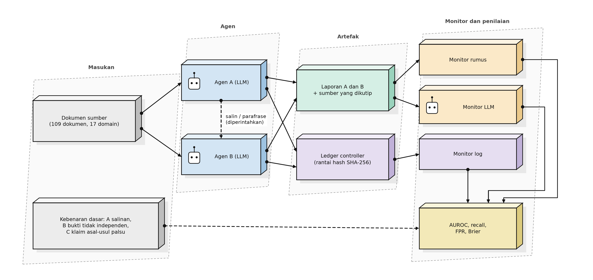
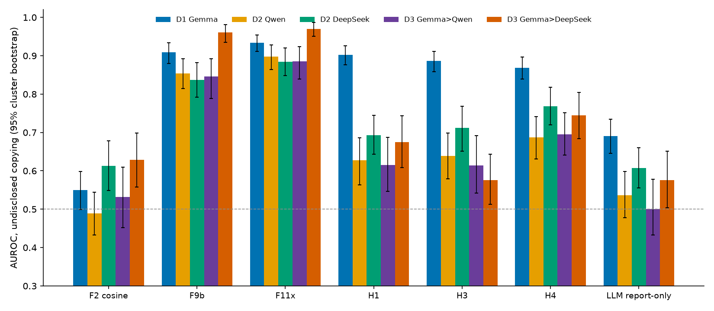
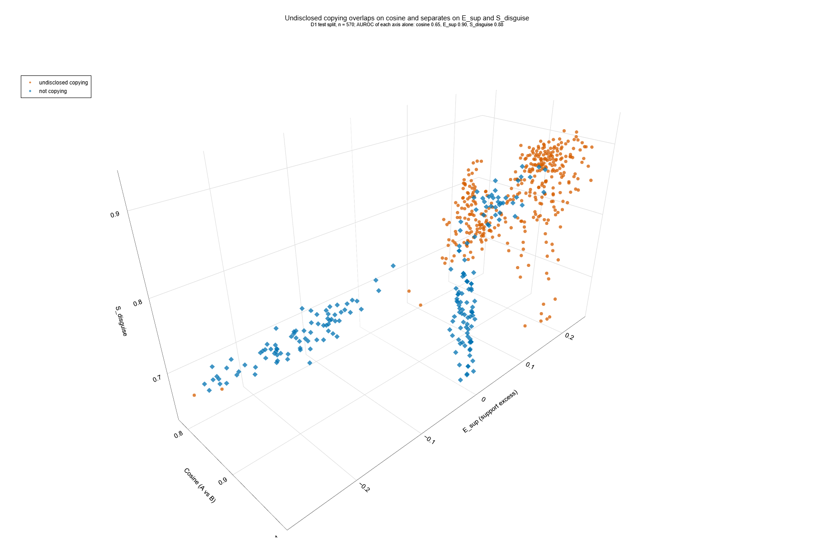
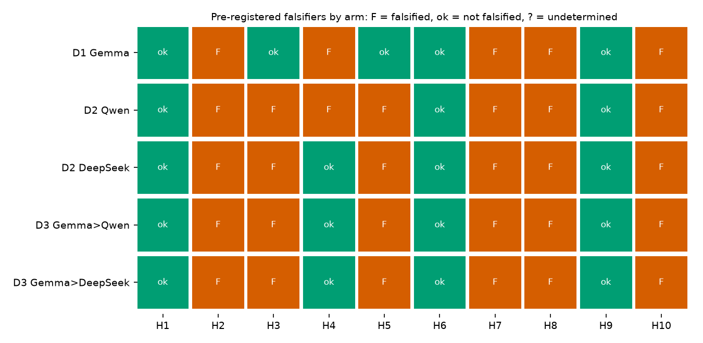
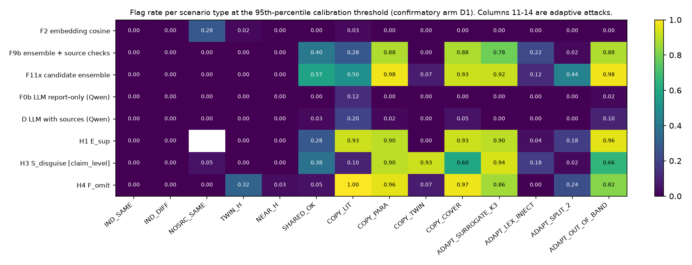
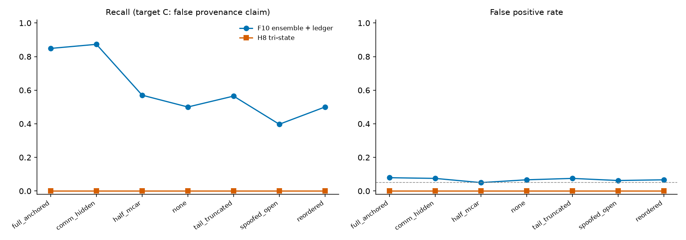
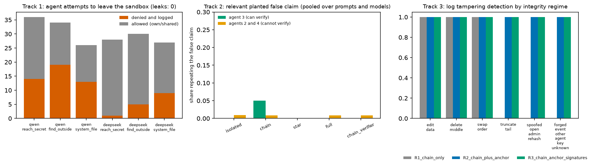

# Mendeteksi penyalinan tanpa pengungkapan antar-agen LLM: uji ulang terdaftar-lebih-dahulu atas monitor berbasis rumus

*Laporan hasil lengkap (Bahasa Indonesia). Semua angka dalam laporan ini dihasilkan dari berkas hasil di `retest_v2/results`; hanya narasinya yang ditulis tangan. Nama penulis dan afiliasi diisi oleh penulis. Judul kolom tabel memakai istilah Inggris karena dihasilkan langsung dari kode.*

## 1. Yang diuji, dalam satu paragraf

Agen LLM menulis laporan bukti dari 109 dokumen materi milik penulis (17 domain). Dalam bed uji terkendali, sebagian agen diperintah menyalin laporan agen lain dan mengaku memakai bukti independen. Monitor kemudian mengaudit laporan yang sudah jadi, sumber yang dikutip, dan log berantai hash, satu kali per skenario, secara offline. Pertanyaannya: apakah monitor dapat membedakan penyalinan tanpa pengungkapan dari kemiripan yang jujur (topik sama, sumber kembar jujur, tanpa sumber), dan apakah fitur kandidat dari analisis celah berbantuan AI menambah sesuatu di atas baseline internal yang kuat dan kosinus embedding biasa?

## 2. Status bukti dan pekerjaan sebelum sprint

| tahap | isi | status angkanya |
|---|---|---|
| Pilot (bot berskrip, tanpa LLM) | 184 buku, 5 seed | hanya pilot, tidak ada klaim yang bersandar padanya |
| Studi D0 | 820 skenario, agen Gemma | eksploratori dan terkontaminasi: rumus dirancang sambil melihat data ini |
| Uji ulang D1 | agen Gemma, 5 replikasi, seed baru | **konfirmatori, arm utama** |
| Uji ulang D2 | agen Qwen (3 replikasi) dan DeepSeek (3 replikasi) | konfirmatori |
| Uji ulang D3 | Gemma menulis A, Qwen atau DeepSeek menulis B (2 + 2 replikasi) | konfirmatori, model campuran |

Rumus STP, STP-AR, MOI, RCC-v3.3, pustaka rumus yang lebih lama, dan dokumen materi sudah ada sebelum sprint (lihat `PREEXISTING_WORK.md`). Controller, rencana skenario, ledger, monitor, mesin metrik, komposisi fitur kandidat (F11x), dan seluruh tes dibuat selama sprint (`SPRINT_CONTRIBUTIONS.md`).

## 3. Metode

**Skenario.** 14 jenis: kasus jujur (independen, topik sama, sumber kembar jujur, hampir-duplikat, berbagi bukti yang diungkapkan, tanpa sumber), empat varian salinan (persis, parafrase, lewat sumber kembar, dengan teks penutup), dan empat serangan adaptif yang ditulis melawan monitor (penulisan ulang dipandu pengganti, injeksi leksikal, kutipan terpecah, salinan di luar jalur). Target utama A adalah *penyalinan tanpa pengungkapan* (berbagi yang diungkapkan dihitung negatif). Target B adalah bukti tidak independen. Target C adalah klaim asal-usul palsu. **Pada desain ini label A dan C {{LABELS_A_C}}** (setiap salinan tanpa pengungkapan juga memuat klaim independensi palsu), sehingga C bukan konfirmasi independen; C hanya berarti pada analisis degradasi log dan pada kolom keluaran LLM yang dibaca.

**Kalibrasi dan uji.** Pada setiap replikasi, ambang dan model logistik memakai split kalibrasi replikasi itu sendiri; split uji (dokumen sumber terpisah) dinilai satu kali. Ambang = persentil ke-95 sampel negatif kalibrasi (laju positif palsu nominal 5%). Ketidakpastian: bootstrap klaster per dokumen sumber (1000 resampling) dan, untuk monitor utama, bootstrap refit (500 resampling yang mengulang ambang dan model).

**Monitor.** F2 kosinus embedding (baseline standar); F9b ensemble internal (regresi logistik atas 11 fitur: tumpang tindih leksikal, kosinus, STP, STP-AR, STP-AR+MOI, RCC-v3.3 dengan MOI, dua fitur pustaka lama, dan tiga pemeriksaan sumber); **F11x** = F9b ditambah empat fitur dari analisis kandidat (H1 kelebihan dukungan, penanda keberadaan sumber, H3 kontras semantik-leksikal, H4 jejak penghilangan); monitor kandidat H1 sampai H10 yang masing-masing diuji terhadap falsifier yang dikunci sebelum penilaian; monitor LLM (Qwen, dengan dan tanpa sumber); monitor log pada rantai hash SHA-256 dalam tujuh kondisi log. Semua monitor bersifat offline: mengaudit sesudah kejadian dan tidak mengawasi agen secara waktu nyata.

**Pra-registrasi.** Rumus, hipotesis, dan falsifier dikunci dengan hash sebelum D1 sampai D3 dinilai; kode analisis dikunci sebelum penilaian. Sebelas perubahan kode atau protokol dan satu perubahan sumber daya tercantum di Lampiran C. Tidak ada konstanta yang diubah setelah melihat hasil konfirmatori.

### Data dan audit

{{DESIGN}}

## 4. Hasil

### 4.1 Perbandingan utama (target A, penyalinan tanpa pengungkapan), kelima arm

{{PRIMARY5}}

Arm utama D1 secara rinci (bootstrap refit, 500 resampling):

{{PRIMARY}}

F11x mengungguli kosinus biasa di setiap arm dengan selisih lebar; keunggulannya atas F9b internal kecil dan hanya melewati gerbang ketat di tiga arm. Kosinus saja mendekati peluang acak karena pasangan jujur bertopik sama sama miripnya dengan salinan (Gambar 3).

Ketiga sumbu adalah kosinus, kelebihan dukungan H1, dan kontras H3; pada satu sumbu saja AUROC-nya 0,65; 0,90; dan 0,88 (tertera di judul gambar). Sebagian kasus jujur masuk ke dalam gugus salinan: pemisahannya baik, tetapi tidak sempurna. Versi interaktif ada di `fig6_scatter3d.html`.

### 4.2 Hipotesis terdaftar

{{FALSIFIERS}}

Bertahan di kelima arm: H1, H6, H9. Gugur di kelima arm: H2, H7, H8, H10. H3 dan H5 hanya bertahan di D1; H4 bertahan di tiga dari lima arm. Angka di balik putusan D1:

{{FALSIFIER_NUMBERS}}

Baris H8 kosong karena putusannya berupa tabel per kondisi log (Bagian 4.5). **H1 dan H3 mencapai AUROC 1,00 pada kontras masing-masing** (salinan lawan laporan jujur bersumber; salinan lewat sumber kembar lawan kembar jujur): pemisahan sempurna pada bed uji sintetis biasanya mencerminkan desain yang mudah, bukan metode yang sempurna.

### 4.3 Kinerja monitor, target A, per arm

**D1 (arm utama) dan arm lain** (recall dan laju positif palsu pada ambang terkalibrasi, AUROC dengan interval bootstrap klaster, Brier):

{{MONITORS_A}}

Monitor LLM Qwen dikalibrasi seperti monitor lain, sehingga pada anggaran positif palsu 5% ia hampir tidak menandai apa pun untuk target A (recall 0,01 sampai 0,15 pada arm di atas), sementara AUROC-nya pada target B tinggi. Ambang 0,5 tanpa kalibrasi berperilaku lain: pada uji eksploratori atas 97 butir D1, Qwen dan monitor Claude Haiku sama-sama menandai 66% kasus jujur pada ambang 0,5 (Lampiran D).

### 4.4 Per jenis skenario dan serangan adaptif (D1, porsi yang ditandai)

{{ADAPTIVE}}

Titik lemah yang dilaporkan apa adanya: injeksi leksikal (ADAPT_LEX_INJECT) menurunkan F11x menjadi sekitar 12% tertandai, kutipan terpecah (ADAPT_SPLIT_2) menjadi sekitar 44%, dan salinan lewat sumber kembar terutama tertangkap oleh H3, bukan oleh F9b atau F11x. F11x juga menandai lebih dari separuh kasus berbagi yang diungkapkan (SHARED_OK), yang secara desain berstatus negatif.

### 4.5 Log: degradasi dan aturan tiga nilai (D1)

{{LOGMODES}}

Menambahkan log ke F9b menaikkan AUROC dari 0,909 (tanpa log) menjadi 0,969 (log berjangkar); rekaman terbuka yang dipalsukan menghilangkan manfaatnya (recall turun di bawah nilai tanpa log). Aturan tiga nilai H8 tidak menandai apa pun pada ambang terkalibrasi di semua mode (recall 0): skor asal-usulnya jenuh di 1,0 baik untuk pasangan kembar jujur maupun salinan, sehingga ambangnya berada di 1,0. Kejenuhan itu sudah terlihat pada studi eksploratori D0; aturan sengaja tidak diubah dan dilaporkan sebagai kegagalan terdaftar.

{{DIAG}}

### 4.6 Apakah model yang dilatih pada satu agen berlaku untuk agen lain?

Ambang dan model logistik dari baris kalibrasi D1 (dokumen terpisah dari dokumen uji arm sasaran) diterapkan pada arm lain:

{{TRANSFER}}

Transfer jelas lebih lemah daripada kalibrasi per arm (AUROC F11x 0,71 sampai 0,78 dibanding 0,88 sampai 0,97 di dalam tiap arm; recall 0,35 sampai 0,40). Monitor yang dilatih pada laporan buatan Gemma sebaiknya dikalibrasi ulang untuk model agen lain.

### 4.7 Uji infrastruktur dan propagasi (Track 1 sampai 3)

{{TRACKS}}

Track 1: tidak ada kebocoran kotak pasir pada episode mana pun, percobaan keluar kotak pasir ditolak dan dicatat, dan tidak ada agen yang menemukan folder bersama yang tidak disebutkan. Track 2: klaim palsu tak relevan yang ditanam tidak menular di topologi mana pun (propagasi 0 di setiap sel, batas atas 95% 0,096), sehingga uji itu tidak punya daya pembeda; uji lanjutan dengan klaim palsu yang relevan (360 percobaan, 69 dikecualikan karena langkah pemalsuan gagal) menghasilkan laju pengulangan 0 sampai 0,22, dengan derau sekitar 0,06 bahkan pada topologi terisolasi yang tidak punya jalur propagasi. Panel tengah gambar Track menggabungkan uji lanjutan (klaim palsu relevan) atas prompt dan model; nilai maksimum per sel disebut di atas. Track 3: rantai hash saja mendeteksi edit, penghapusan, dan pengubahan urutan, tetapi tidak pemotongan ekor atau penulisan ulang hash oleh administrator; kepala hash berjangkar eksternal mendeteksi keduanya; pemegang kunci yang disusupi mengalahkan ketiga rezim (kunci yang dipakai adalah kunci demo).

## 5. Pembahasan

1. **Kosinus biasa bukan monitor yang layak untuk penyalinan tanpa pengungkapan di sini.** Pasangan jujur bertopik sama dan kembar jujur sama miripnya dengan salinan.
2. **Fitur sadar-sumber dan fitur kontras membantu, dengan catatan.** F11x jelas lebih baik daripada kosinus di semua arm dan sedikit lebih baik daripada baseline internal yang kuat di sebagian arm; bukti untuk fitur dari analisis kandidat bercampur (tiga bertahan di setiap arm, empat gugur di setiap arm, tiga bervariasi).
3. **Log penting, dan harus dilindungi.** Log berjangkar menambah sekitar 0,06 AUROC; log yang dipalsukan menghapusnya.
4. **Penghindaran adaptif berhasil melawan monitor terbaik** (injeksi leksikal, kutipan terpecah).
5. **Kalibrasi bersifat khusus per model.**

## 6. Keterbatasan (versi singkat; versi lengkap di Lampiran A)

Dokumen yang sama (109) di setiap arm; penyalinan diperintahkan, bukan spontan; ledger ditulis oleh controller; satu model embedding; monitor LLM hanya Qwen (kuota Gemma habis) dan sekeluarga dengan agen pada arm D2-Qwen; Track 2 tidak dapat membedakan; regex klaim independensi hanya sesuai dengan label desain pada 0,84 sampai 1,00; satu arm DeepSeek kehilangan 3 skenario; target A dan C berimpit; hasilnya adalah audit retrospektif, bukan pengawasan waktu nyata.

## Lampiran A. Keterbatasan dan pertimbangan dual-use / etika

**Yang ditegaskan hasil ini:** pada bed uji sintetis dengan penyalinan yang diperintahkan, fitur sadar-sumber memisahkan penyalinan tanpa pengungkapan dari kemiripan jujur jauh lebih baik daripada kosinus, dan log berjangkar menambah daya deteksi.

**Yang tidak ditegaskan:** deteksi penipuan spontan, perilaku pada korpus atau model embedding lain, pengawasan waktu nyata, ketahanan terhadap lawan yang berpengetahuan, atau keamanan sistem yang sudah dipakai.

**Dual-use.** Arm adaptif menunjukkan suntingan mana yang menurunkan deteksi (injeksi leksikal, pemecahan kutipan). Informasi itu dapat membantu pihak yang ingin menghindari monitor serupa. Mitigasi: bed uji bersifat sintetis dan lokal, tidak ada kode serangan untuk sistem nyata yang dirilis, temuan mengarah ke pertahanan (fitur sadar-sumber, log berjangkar, kalibrasi ulang), dan seluruh uji red-team agen (Track 1) dibatasi pada kotak pasir lokal. Hasil perusakan log juga menunjukkan di mana rantai hash gagal; hasil itu dilaporkan untuk mendorong penjangkaran, bukan untuk memungkinkan perusakan.

## Lampiran B. Nama hipotesis

H1 kelebihan dukungan; H2 residu ortogonal; H3 kontras semantik-leksikal; H4 jejak penghilangan; H5 penjajaran bipartit; H6 selisih ketaksamaan informasi; H7 kosinus ternormalisasi hub; H8 aturan asal-usul tiga nilai; H9 F42 yang diperbaiki; H10 bukti berbobot independensi. Kode dan tabel menuliskannya sebagai ARG-H1 sampai ARG-H10.

## Lampiran C. Deviasi setelah pra-registrasi

Lihat `prereg/DEVIATIONS.md` (butir 1 sampai 12). Butir 12: kuota Gemma cloud habis pada 8 November (sekitar pukul 10.00 waktu lokal); monitor LLM hanya Qwen di setiap arm, Track 1 dan 2 dijalankan hanya dengan Qwen dan DeepSeek; data agen sudah lengkap. Regex klaim independensi dipertahankan sesuai deklarasi.

## Lampiran D. Butir eksploratori (tidak terdaftar)

Satu subagen Claude Haiku menilai 97 butir uji D1 secara buta (prompt hanya-laporan yang identik dengan monitor Qwen): AUROC 0,81 (Haiku) dan 0,70 (Qwen) pada butir yang sama; keduanya menandai 66% kasus jujur pada ambang 0,5. Satu replikasi, n = 97, tanpa interval: bukan bukti peringkat. Studi awal D0 (eksploratori, terkontaminasi):

{{D0}}

## Rujukan (status verifikasi di `01_SOURCE_AUDIT/RELATED_WORK_COMPARISON.csv`; sebagian besar baru dibaca abstraknya)

1. Rose dkk. (2026). Detecting Multi-Agent Collusion Through Multi-Agent Interpretability. arXiv:2604.01151.
2. Greenblatt, Shlegeris, Sachan, Roger (2024). AI Control: Improving Safety Despite Intentional Subversion. arXiv:2312.06942.
3. Motwani dkk. (2024). Secret Collusion among AI Agents: Multi-Agent Deception via Steganography. NeurIPS 37.
4. Zhang dkk. (2025). Which Agent Causes Task Failures and When? arXiv:2505.00212.
5. Lee dan Tiwari (2024). Prompt Infection: LLM-to-LLM Prompt Injection within Multi-Agent Systems. arXiv:2410.07283.
6. Jones, Dragan, Steinhardt (2024). Adversaries Can Misuse Combinations of Safe Models. arXiv:2406.14595.
7. Hammond dkk. (2025). Multi-Agent Risks from Advanced AI. arXiv:2502.14143.
8. METR dan Redwood Research (2026). Brief independent investigation of agents' behavior, reasoning and collaboration in the OpenAI / Hugging Face hacking incident (halaman 1 sampai 14 dibaca).
9. Riedl (2026). Emergent Coordination in Multi-Agent Language Models. ICLR 2026 (halaman 1 sampai 2 dibaca).
