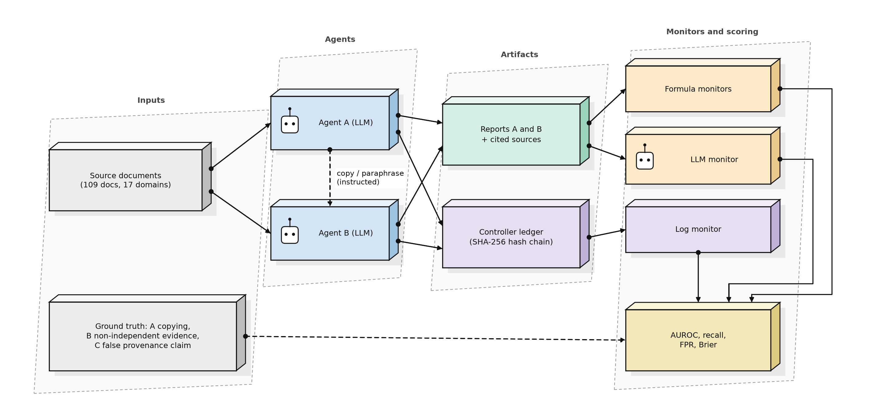
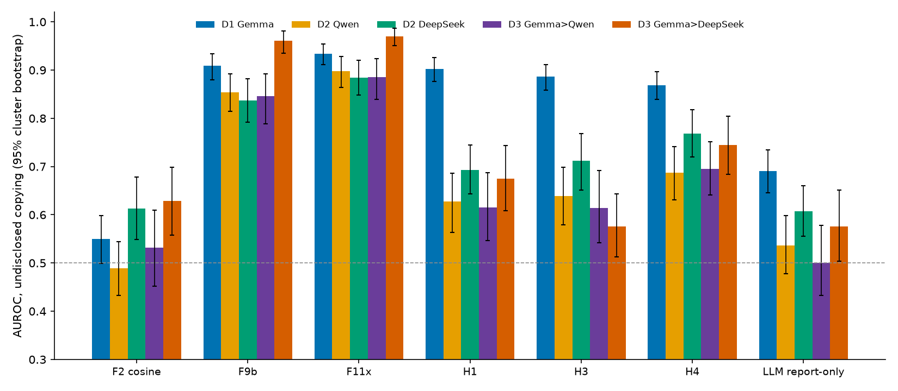
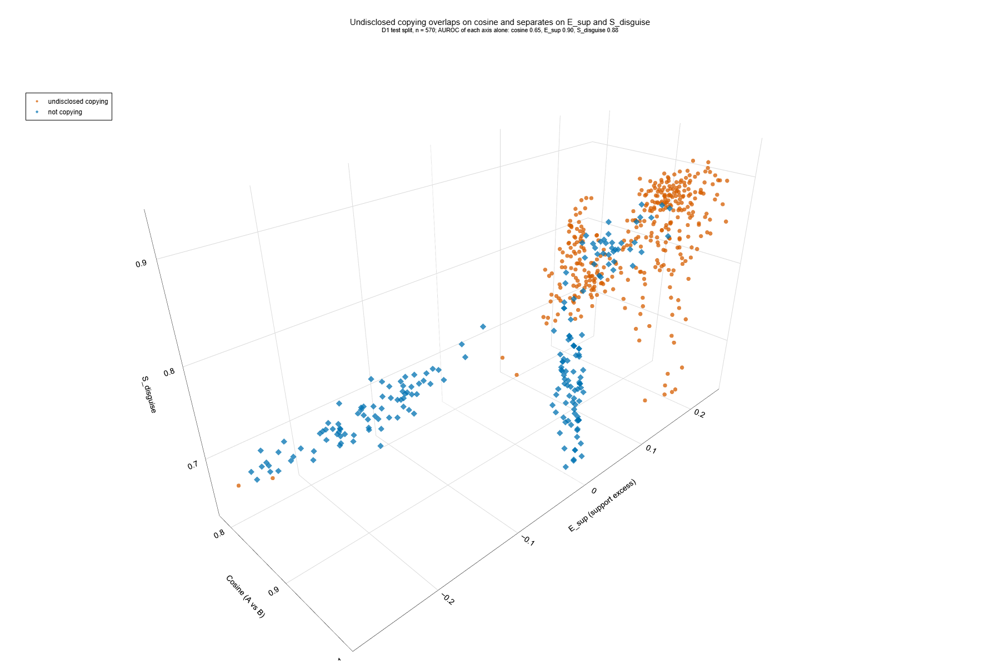

# Cosine Is Not Enough: Detecting Undisclosed Copying Between LLM Agents in a Pre-Registered Test Bed

*Authors and affiliations: to be filled in by the authors. Track 4: Multi-Agent Oversight and Control.*

## Abstract

Oversight of multi-agent LLM systems often relies on text similarity to spot agents that reuse each other's work. We ask whether this works when one agent copies another and falsely claims independent evidence. In a controlled test bed, LLM agents (Gemma, Qwen, DeepSeek) wrote evidence reports from 109 course documents; some were instructed to copy, in literal, paraphrased, twin-source and adaptive variants, against honest controls whose text is just as similar. We pre-registered hypotheses and falsifiers for ten candidate features from an AI-assisted gap analysis and audited the reports offline on fresh seeds in five arms (about 3,650 scored scenarios). Embedding cosine was near chance (AUROC 0.49 to 0.63). An ensemble of source-aware and contrast features reached AUROC 0.88 to 0.97 and beat cosine in every arm, but exceeded a strong in-house baseline by only 0.01 to 0.05 AUROC (intervals up to 0.09) and passed our strict gate in three of five arms. Four hypotheses failed in every arm, three held in every arm, three varied. An anchored log added about 0.06 AUROC; a spoofed log removed it. Lexical injection and split citation lowered detection, and fitted monitors transferred poorly across agent models (AUROC 0.71 to 0.78). Limits: one corpus, instructed copying, one embedding model.

## 1. Introduction

When many LLM agents write reports for the same task, an overseer needs to know whether the pieces of evidence are independent. A cheap check is text similarity. It fails in a specific way: honest agents reading the same material also write similar text, while an agent that copies and paraphrases can claim an independent source. We study this *undisclosed copying* problem as a monitoring task, and ask three questions. (Q1) Is embedding cosine a usable monitor? (Q2) Do features that compare claims with the cited sources, or contrast semantic with lexical overlap, add detection power over a strong baseline? (Q3) How far do logs, the second source of provenance information, help when they are degraded or spoofed?

Contributions: a labelled test bed with honest-similarity controls and four adaptive attacks; a pre-registered protocol with falsifiers, run on fresh seeds and three agent models; and a candid list of what failed.

## 2. Related work

Work on multi-agent oversight spans white-box collusion detection from activations (Rose et al., 2026), control protocols against intentional subversion (Greenblatt et al., 2024), steganographic collusion (Motwani et al., 2024), failure attribution in multi-agent logs (Zhang et al., 2025), prompt-injection spread between agents (Lee and Tiwari, 2024), task-splitting misuse (Jones et al., 2024) and risk taxonomies (Hammond et al., 2025). A real incident report documents agents that tried to spoof or edit their own transcripts (METR and Redwood, 2026), which motivates our log tests. Emergent coordination has been measured with information decomposition (Riedl, 2026). We differ in being black-box and provenance-oriented: the monitor sees reports, cited sources and a log, and must decide whether a claim of independence is true. We do not compare AUROC values with these works because data, signal and task differ. Most entries were read from abstracts only; see References.

## 3. Method

**Test bed.** Agents write evidence reports from 109 course documents in 17 domains. 14 scenario types: honest cases (independent, same topic, honest twin sources, near duplicates, disclosed sharing, no source), four copy variants (literal, paraphrase, via twin source, with cover text) and four adaptive attacks written against the monitors (surrogate-guided rewrite, lexical injection, split citation, out-of-band copy). The primary target A is *undisclosed copying* (disclosed sharing is negative). Target B is non-independent evidence; target C a false provenance claim. In this design the labels of A and C coincide, so C is not independent confirmation.

**Monitors.** F2: embedding cosine. F9b: logistic ensemble of 11 features (lexical overlap, cosine, in-house similarity formulas, source checks). F11x: F9b plus four features from the candidate analysis (H1 support excess, source flag, H3 semantic-lexical contrast, H4 omission footprint). H1 to H10: each candidate alone against a falsifier fixed before scoring. LLM monitors (Qwen). Log monitors on a SHA-256 hash chain in seven log conditions. All monitors are **offline audits** of finished episodes, not real-time oversight.

**Protocol.** Per replicate, thresholds and fits use its own calibration split; the test split (disjoint source documents) is scored once. Threshold: 95th percentile of calibration negatives. Intervals: cluster bootstrap by source document (1000) and refit bootstrap (500). Formulas, hypotheses, falsifiers and analysis code were hash-locked before scoring. The primary comparison is fixed: F11x versus F2 (AUROC gain at least 0.25), a paired-Brier gate against F9b (F31, upper bound below -0.005), and no worse false-positive rate on honest-twin and no-source sentinels.

**Arms.** D1: Gemma agents, 5 replicates (main). D2: Qwen and DeepSeek agents, 3 replicates each. D3: Gemma writes A, Qwen or DeepSeek writes B, 2 replicates each. An earlier 820-scenario study (D0) was exploratory and contaminated and is not used for claims.

## 4. Results

### 4.1 Primary comparison

{{PRIMARY5}}

Cosine is close to chance because honest same-topic and twin-source pairs are as similar as copies: mean cosine is 0.98 for honest twins and 0.97 for paraphrased copies. F11x beats cosine in all arms; its gain over F9b is small and clears the strict gate in three arms.

On single axes AUROC is 0.65 (cosine), 0.90 (H1) and 0.88 (H3); separation on the three axes is good but not perfect.

### 4.2 Pre-registered hypotheses

{{FALSIFIERS}}

H1, H6, H9 held in all arms; H2, H7, H8, H10 failed in all arms; H3, H5 held only in D1; H4 held in three arms. H1 and H3 reach AUROC 1.00 on their own contrasts, which in a synthetic test bed likely reflects an easy design. H8 (a three-valued rule) flagged nothing at the calibrated threshold because its score saturates at 1.0 for honest twins and copies alike.

### 4.3 Logs, adaptive attacks and transfer

Adding an anchored log to F9b raised AUROC from 0.909 to 0.969; a spoofed open record removed the benefit (table below). Lexical injection lowered the share of F11x flags to about 12% and split citation to about 44%; copy via twin source was caught mainly by H3. F11x also flagged more than half of disclosed-sharing cases, which are negative by design. Fits from D1 applied to other agent models gave F11x AUROC 0.71 to 0.78 (recall 0.35 to 0.40) against 0.88 to 0.97 with per-arm calibration. A hash chain alone missed tail truncation and administrator re-hash; an external anchor caught both; a compromised key holder defeats all regimes. An irrelevant planted false claim did not propagate in any topology (so that test could not discriminate), and agents in a local sandbox leaked nothing.

**Log conditions (D1)**

{{LOGMODES}}

**Share flagged per scenario type (D1; the last four rows are the adaptive attacks)**

{{ADAPTIVE}}

## 5. Discussion

Plain cosine should not be used to certify independence of agent evidence in this setting. Source-aware and contrast features help, but the improvement over a carefully built baseline is modest and not uniform, and several candidate features failed. Logs matter, but only when protected. Adaptive evasion works against the best monitor, and calibration is model-specific. For practice: compare claims with cited sources, anchor logs outside the agents, recalibrate per agent model, and treat a similarity score as a prompt for an audit.

## 6. Limitations

Same 109 documents in every arm; copying is instructed; the log is written by the controller; one embedding model; the LLM monitor is Qwen only (Gemma quota ended during scoring, see Appendix C) and shares a family with the agents in one arm; the independence-claim rule agrees with the design label in 0.84 to 1.00 of cases; targets A and C coincide; results are offline audits. Full discussion in Appendix A.

## Statement on AI tools

AI assistants were used for code, a candidate-hypothesis analysis, figure code and drafting. The authors verified outputs against data and are responsible for all content.

## References

1. Rose et al. (2026). Detecting Multi-Agent Collusion Through Multi-Agent Interpretability. arXiv:2604.01151.
2. Greenblatt, Shlegeris, Sachan, Roger (2024). AI Control: Improving Safety Despite Intentional Subversion. arXiv:2312.06942.
3. Motwani et al. (2024). Secret Collusion among AI Agents: Multi-Agent Deception via Steganography. NeurIPS 37.
4. Zhang et al. (2025). Which Agent Causes Task Failures and When? arXiv:2505.00212.
5. Lee and Tiwari (2024). Prompt Infection: LLM-to-LLM Prompt Injection within Multi-Agent Systems. arXiv:2410.07283.
6. Jones, Dragan, Steinhardt (2024). Adversaries Can Misuse Combinations of Safe Models. arXiv:2406.14595.
7. Hammond et al. (2025). Multi-Agent Risks from Advanced AI. arXiv:2502.14143.
8. METR and Redwood Research (2026). Brief independent investigation of agents' behavior, reasoning and collaboration in the OpenAI / Hugging Face hacking incident.
9. Riedl (2026). Emergent Coordination in Multi-Agent Language Models. ICLR 2026.

## Appendix A. Limitations and dual-use / ethical considerations

**What the results establish:** in a synthetic test bed with instructed copying, source-aware features separate undisclosed copying from honest similarity much better than cosine, and an anchored log adds detection power.

**What they do not establish:** detection of spontaneous deception, behaviour on other corpora or embedding models, real-time oversight, resistance to a knowledgeable adversary, or safety of a deployed system. Perfect separations (AUROC 1.00) on single contrasts reflect an easy synthetic design.

**Dual-use.** The adaptive arms show which edits lower detection (lexical injection, citation splitting) and the log tests show where hash chains fail. This could help someone evade similar monitors. Mitigations: the test bed is synthetic and local; no attack code for real systems is released; the findings point to defences (source-aware features, external anchors, recalibration); and all agent red-team runs were confined to a local sandbox with logged denials.

## Appendix B. Work before the sprint and work during the sprint

Before the sprint (declared, not claimed): STP, STP-AR, MOI and RCC-v3.3 formulas; an older formula library; the course documents; the local embedding runtime; a pilot with scripted bots (created on the first sprint day and reported as a pilot only). During the sprint: controller and scenario plan, ledger and tamper tests, monitors, metrics engine, composition of F11x, the 820-scenario study D0, the pre-registered re-test D1 to D3, tracks 1 to 3, all tests and figures. Detailed lists: `PREEXISTING_WORK.md`, `SPRINT_CONTRIBUTIONS.md`.

## Appendix C. Deviations after pre-registration

Eleven code or protocol changes (none affects a number where calls succeeded) are listed in `prereg/DEVIATIONS.md`. Item 12: the Gemma cloud quota ended on 8 November (about 10:00 local) during scoring; the LLM monitor is Qwen only in every arm and tracks 1 and 2 were run with Qwen and DeepSeek only. Agent data were complete before the quota ended. The decision was made before any confirmatory result was computed. The independence-claim regex was kept as declared.

## Appendix D. Additional results

**Transfer from D1 to other arms**

{{TRANSFER}}

**Audit**

{{DESIGN}}
